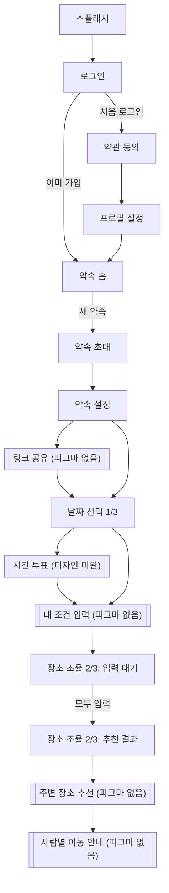
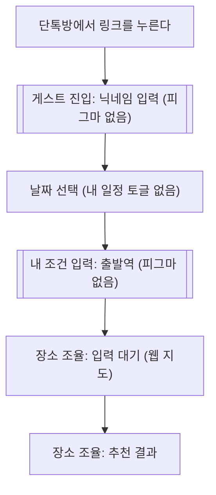

# moa-app 구조 설계

- 기준일: 2026-11-12
- 근거: 피그마 파일 `201_figma_for_Dev`(페이지 `Page 1`), 레포 `CLAUDE.md`, 개인 위키의 moa 결정 문서(2026-11-06 ~ 11-12), Expo 공식 문서(SDK 58)
- 이 문서는 설계만 담는다. 코드는 없다. 타입 표기는 "데이터가 이런 모양이다"를 보여주는 스케치다.

## 0. 읽는 법

**표시**

| 표시 | 뜻 |
|---|---|
| 확정 | 위키 또는 대화에서 정해진 것 |
| 제안 | 이 문서가 권하는 안. PR 리뷰에서 바꿀 수 있다 |
| 미결정 | 아직 정하지 않은 것. 선택지만 적는다 |
| 피그마 없음 | 흐름상 필요하지만 피그마에 화면이 없는 것 |

**이 문서를 쓰기 전에 정한 것 (2026-11-12)**

- 가능 시간 입력은 **피그마 방식(달력에서 날짜 선택 + 시간 휠)으로 통일**한다. 앱과 게스트 웹이 같은 화면을 쓴다. When2meet식 드래그 그리드는 만들지 않는다. 이 문서에서 "타임 그리드"는 날짜 선택 화면의 달력을 가리킨다.
- `날짜 선택_4`, `날짜 선택_4-1`은 디자인 미완이다. 화면 목록에 이름만 올리고 상세 설계에서는 뺀다.
- `Frame 46`, `Frame 47`, 카카오톡 캡처, `동하 자차 이동 비교표`는 참고 자료다. `날짜 선택_4-2`, `image 77`은 작업 흔적이라 무시한다.

**위키에서 미결정인 것.** 아래 셋은 이 문서 어디에서도 정해진 것으로 쓰지 않는다. 선택지는 8.1에 있다.

- 길찾기 API와 중간 지점 알고리즘
- 실시간 반영 방식
- 게스트 인증 방식

## 1. 화면 목록

피그마 프레임 13개가 화면 9개로 묶인다. 같은 화면의 상태(예: 달력이 비었을 때와 날짜를 골랐을 때)는 프레임이 여러 개여도 화면 하나로 센다.

피그마 링크는 모두 `https://www.figma.com/design/5hgy25TU98Xwb54d29bfLG/201_figma_for_Dev?node-id=<노드>` 꼴이다.

| # | 화면 | 피그마 프레임 | 역할 |
|---|---|---|---|
| 1 | 스플래시 | [Splash Screen](https://www.figma.com/design/5hgy25TU98Xwb54d29bfLG/201_figma_for_Dev?node-id=9-2578) | 앱을 여는 동안 보이는 네이비 배경. 로고는 아직 없다 |
| 2 | 로그인 | [LOGIN1.](https://www.figma.com/design/5hgy25TU98Xwb54d29bfLG/201_figma_for_Dev?node-id=6-2298) | 카카오, 구글, 네이버, 애플 로그인. 마지막에 쓴 수단에 "최근 로그인" 말풍선 |
| 3 | 약관 동의 | [LOGIN2.](https://www.figma.com/design/5hgy25TU98Xwb54d29bfLG/201_figma_for_Dev?node-id=1-3830) | 필수 4개, 선택 3개 동의. 선택 항목에 "내 캘린더 일정 불러오기"가 있다 |
| 4 | 프로필 설정 | [LOGIN3.](https://www.figma.com/design/5hgy25TU98Xwb54d29bfLG/201_figma_for_Dev?node-id=49-2421) | 이름(2~10자)과 프로필 사진 |
| 5 | 약속 홈 | [MAIN.](https://www.figma.com/design/5hgy25TU98Xwb54d29bfLG/201_figma_for_Dev?node-id=1-3715) | 오늘의 약속 카드, 다음 약속 목록, 탭 바 |
| 6 | 약속 초대 | [약속 생성_1](https://www.figma.com/design/5hgy25TU98Xwb54d29bfLG/201_figma_for_Dev?node-id=70-2893) | 친구를 검색해서 고른다 |
| 7 | 약속 설정 | [약속 생성_2](https://www.figma.com/design/5hgy25TU98Xwb54d29bfLG/201_figma_for_Dev?node-id=70-2959) | 약속 이름(50자)과 사진 |
| 8 | 날짜 선택 | [_1](https://www.figma.com/design/5hgy25TU98Xwb54d29bfLG/201_figma_for_Dev?node-id=1-4014) 빈 달력 · [_1-2](https://www.figma.com/design/5hgy25TU98Xwb54d29bfLG/201_figma_for_Dev?node-id=1-4090) 날짜 선택됨 · [_2](https://www.figma.com/design/5hgy25TU98Xwb54d29bfLG/201_figma_for_Dev?node-id=1-4517) 내 일정 켬 · [_3](https://www.figma.com/design/5hgy25TU98Xwb54d29bfLG/201_figma_for_Dev?node-id=1-4171) 시간 입력 패널 | 가능한 날짜를 고르고 시작·종료 시간을 넣는다. "내 일정" 토글을 켜면 기기 캘린더 일정이 달력에 겹쳐 보인다 |
| 9 | 장소 조율 | [_1](https://www.figma.com/design/5hgy25TU98Xwb54d29bfLG/201_figma_for_Dev?node-id=1-4274) 입력 대기 · [_2](https://www.figma.com/design/5hgy25TU98Xwb54d29bfLG/201_figma_for_Dev?node-id=1-4340) 추천 결과 | 지도에 참가자 출발지를 보여준다. 모두 입력하면 추천 중간 지점과 사람별 이동수단, 소요시간, 환승 횟수를 보여준다 |

**디자인 미완 (상세 설계 제외)**

| 프레임 | 보이는 내용 |
|---|---|
| [날짜 선택_4](https://www.figma.com/design/5hgy25TU98Xwb54d29bfLG/201_figma_for_Dev?node-id=1-4441) | 내 일정을 켠 달력에서 고른 날짜가 네이비 막대로 표시된다 |
| [날짜 선택_4-1](https://www.figma.com/design/5hgy25TU98Xwb54d29bfLG/201_figma_for_Dev?node-id=44-2121) | "언제가 제일 좋아요?" 모두 되는 시간 후보 3개 중에서 투표한다 |

**공용 자산**

| 프레임 | 내용 |
|---|---|
| [Component](https://www.figma.com/design/5hgy25TU98Xwb54d29bfLG/201_figma_for_Dev?node-id=70-4200) | 컴포넌트 10묶음. 4장에서 다룬다 |
| [Foundation](https://www.figma.com/design/5hgy25TU98Xwb54d29bfLG/201_figma_for_Dev?node-id=85-2389) | 색과 글꼴. 6장에서 다룬다 |

**피그마 없음.** 위키의 서비스 흐름에는 있지만 피그마에 없는 화면이다. 라우트 자리만 잡아 두고 디자인이 나오면 채운다.

- 게스트 진입: 닉네임 입력
- 내 조건 입력: 출발지와 이동수단. 장소 조율_1에 "내 조건 · 신림역 · 대중교통 · 수정" 줄이 있지만 수정 화면이 없다
- 주변 장소 추천: 장소 조율_2의 "이 근처로 장소 고르기" 다음 단계
- 사람별 이동 안내
- 약속 링크 공유
- 탭 2번, 3번 화면
- 약속 상세: 홈에서 확정된 약속 카드를 눌렀을 때
- 약관 상세: 약관 줄의 `>`를 눌렀을 때

## 2. 라우트 구조

### 2.1 파일 트리 (제안)

```
src/app/
├── _layout.tsx               Root Stack. 글꼴 로딩, 스플래시 숨김, 보호 라우트
├── +not-found.tsx
├── (auth)/
│   ├── _layout.tsx           Stack
│   ├── login.tsx             로그인            /login
│   ├── terms.tsx             약관 동의         /terms
│   └── profile-setup.tsx     프로필 설정       /profile-setup
├── (tabs)/
│   ├── _layout.tsx           Tabs (커스텀 탭 바)
│   ├── index.tsx             약속 홈           /
│   └── (탭 2, 3)             피그마 없음. 이름은 정해지면 만든다
├── plans/
│   ├── new/
│   │   ├── _layout.tsx       Stack
│   │   ├── invite.tsx        약속 초대         /plans/new/invite
│   │   └── details.tsx       약속 설정         /plans/new/details
│   └── [planId]/
│       ├── _layout.tsx       Stack
│       ├── dates.tsx         날짜 선택         /plans/123/dates
│       └── place.tsx         장소 조율         /plans/123/place
└── join/
    └── [code].tsx            게스트 진입       /join/abc123   (피그마 없음)
```

- `(auth)`, `(tabs)`처럼 괄호로 감싼 폴더는 주소에 나타나지 않는다. 화면을 묶어 같은 네비게이터를 씌우는 용도다.
- 스플래시는 라우트가 아니다. `expo-splash-screen` 설정(`app.json`)으로 처리한다.
- 날짜 선택의 프레임 4개와 장소 조율의 프레임 2개는 각각 라우트 하나의 상태다.
- 피그마가 나오면 `[planId]/` 아래에 `conditions.tsx`(내 조건), `spots.tsx`(주변 장소), `routes.tsx`(이동 안내), `vote.tsx`(시간 투표)가 붙을 자리다. 지금은 만들지 않는다.

### 2.2 네비게이터 종류와 이유

| 위치 | 종류 | 이유 |
|---|---|---|
| Root | Stack, 헤더 숨김 | 로그인 흐름, 탭, 약속 흐름을 한 층에서 오가게 한다. 피그마 상단 바는 단계 표시줄이 붙은 커스텀 디자인이라 기본 헤더를 쓰지 않는다. 화면 전환과 뒤로 가기 제스처는 네이티브 Stack의 것을 그대로 쓴다 |
| `(auth)` | Stack | 로그인 → 약관 → 프로필이 한 줄로 이어진다 |
| `(tabs)` | Tabs | 홈에만 탭 바가 보이고, 약속 흐름으로 들어가면 Root Stack 위에 쌓여 탭 바가 가려진다 |
| `plans/new` | Stack | 초대 → 설정 두 단계. 약속이 만들어지면 흐름 전체를 `replace`로 치워서 뒤로 가기로 돌아오지 않게 한다 |
| `plans/[planId]` | Stack | 날짜(1/3) → 장소(2/3) → 다음 단계로 이어지는 단계형 흐름 |
| Modal | 지금은 없음 | 약관 상세가 디자인되면 `presentation: 'modal'`의 후보다 |
| Bottom Sheet | 네비게이터가 아니라 화면 안 컴포넌트 | 아래 2.4 |

### 2.3 탭 바 (제안: JavaScript Tabs + 커스텀 탭 바)

피그마 탭 바(`Navigation/Tab Bar`)는 위쪽 모서리가 둥근 흰 판에 아이콘 3개만 있는 커스텀 모양이다.

| 선택지 | 장점 | 단점 |
|---|---|---|
| **A. `expo-router`의 Tabs + 커스텀 `tabBar` (제안)** | 피그마 모양 그대로 만들 수 있다. 웹에서도 같게 보인다 | 탭 바를 직접 그려야 한다 |
| B. NativeTabs (`expo-router/native-tabs`, 지금 템플릿이 쓰는 것) | 코드가 거의 없다. iOS 시스템 탭 바 느낌 | 모양을 바꿀 수 없다. iOS 26에서는 배경색도 시스템이 정한다. 웹에서는 기본 대체 UI가 나온다 |
| C. 헤드리스 탭 (`expo-router/ui`) | 완전히 자유롭다 | 가장 손이 많이 간다 |

Expo 문서는 시스템 탭으로 안 되는 디자인이면 JavaScript 탭이나 커스텀 탭을 쓰라고 안내한다. 일정이 빠듯하면 B로 시작하고 나중에 A로 바꿔도 라우트 구조는 그대로다.

### 2.4 하단 패널과 시트 (제안: 화면 안 컴포넌트)

- **날짜 선택의 시간 입력 패널(날짜 선택_3).** 화면 가장자리까지 붙은 시트가 아니라 달력과 하단 버튼 사이에 뜨는 카드다. 패널이 열려도 "다음" 버튼이 그대로 보인다. 그래서 라우트를 따로 두지 않고 `dates.tsx` 안의 상태로 다룬다.
- **장소 조율의 하단 패널.** 지도 위에 손잡이가 달린 패널이 올라와 있다. 선택지는 셋이다.

| 선택지 | 장점 | 단점 |
|---|---|---|
| **A. 화면 안 패널을 직접 구현 (제안)** | 이미 설치된 `gesture-handler`와 `reanimated`만 쓴다. 웹에서도 같은 화면이다. 처음에는 고정 높이로 만들고 드래그는 나중에 붙일 수 있다 | 드래그 동작을 직접 만들어야 한다 |
| B. Expo Router `formSheet` 라우트 | 네이티브 시트 느낌. 뒤의 지도를 계속 만질 수 있게 하는 옵션이 있다 | 웹에서는 별도 페이지로 열린다(게스트 웹에 맞지 않는다). Android는 높이 단계가 3개까지이고 시트 안에 헤더를 못 쓴다 |
| C. 바텀 시트 라이브러리 추가 | 동작이 검증돼 있다 | 의존성이 늘어난다. SDK 58, reanimated 4와 맞는지 확인이 필요하다 |

### 2.5 보호 라우트

"로그인해야 볼 수 있는 화면"은 Root 레이아웃에서 `Stack.Protected`의 `guard`로 나눈다. 조건이 거짓이면 그 화면으로 갈 수 없고 다른 화면으로 돌려보낸다(SDK 58부터 `redirectTo`로 돌려보낼 곳을 정할 수 있다).

| 묶음 | 열리는 조건 |
|---|---|
| `(auth)` | 로그인, 약관, 프로필 중 하나라도 안 끝났을 때 |
| `(tabs)`, `plans/new` | 로그인, 약관, 프로필이 모두 끝났을 때 |
| `plans/[planId]` | 세션이 있을 때. 세션은 회원 로그인 또는 게스트 세션이다. 게스트 세션을 어떻게 만드는지는 **미결정**(8.1) |
| `join/[code]` | 항상 |

주의할 점이 있다. Expo 문서에 따르면 이 보호는 **기기(클라이언트)에서만** 동작한다. 실제 접근 제어는 백엔드 API가 해야 한다.

### 2.6 웹(게스트)에서 달라지는 것

같은 라우트를 웹에서도 쓰고, 네이티브 전용 부분만 파일을 나눈다(위키 2026-11-06 확정).

- **지도.** `src/components/map/` 아래에 네이티브용과 `.web.tsx`를 둔다. 라우트 파일은 나누지 않는다. `src/app/` 안에서 `.web.tsx`를 쓰려면 플랫폼 구분 없는 기본 파일이 반드시 같이 있어야 한다는 제약이 있어서, 컴포넌트 쪽에서 나누는 편이 단순하다.
- **캘린더.** `expo-calendar`는 웹에서 동작하지 않는다. 웹에서는 "내 일정" 토글을 숨긴다.
- **웹 출력 방식은 미결정이다.** `/join/[code]`처럼 주소 일부가 그때그때 달라지는 라우트 때문이다. 8.3의 T4를 본다.

## 3. 사용자 흐름

피그마 캔버스의 왼쪽 → 오른쪽 순서를 따랐다. 점선 상자는 피그마에 없는 화면이다.

### 3.1 호스트: 약속을 만들고 공유한다



- 홈에서 "새 약속"으로 가는 버튼이 피그마에 분명하지 않다(8.2의 D2).
- 날짜 선택 안에서의 순서: 날짜를 누른다 → 하단에 고른 날짜 요약이 뜬다 → 필요하면 "내 일정"을 켜서 캘린더 일정을 겹쳐 본다 → 시간 패널에서 시작·종료를 넣고 확인한다.
- 초대받은 앱 사용자는 홈의 "다음 약속" 목록에서 약속을 눌러 그 약속의 현재 단계로 들어간다. 어느 화면으로 보낼지는 약속의 `status`로 정한다.
- 링크를 언제 공유하는지, 날짜 선택과 약속 설정의 순서가 맞는지는 열린 질문이다(8.2의 D1, D3).

### 3.2 게스트: 웹 링크로 참여한다



- 가입하지 않는다. 닉네임만 넣는다(위키 2026-11-06 확정).
- 게스트를 서버가 어떻게 알아보는지(게스트 인증)는 **미결정**이다(8.1).
- 호스트 전용인 것: 캘린더 연동, 네이티브 지도, 출발 알림.

## 4. 컴포넌트 트리

### 4.1 폴더 나누기

| 폴더 | 들어가는 것 |
|---|---|
| `src/components/ui/` | 디자인 시스템 단위. 어느 화면에서나 쓰고, 약속이나 사람 같은 도메인을 모른다 |
| `src/components/` | 여러 화면이 함께 쓰는 조립 부품(상단 바, 탭 바) |
| `src/components/<기능>/` | 한 기능 화면에서만 쓰는 부품. `auth`, `plan`, `calendar`, `place`, `map` |

### 4.2 피그마 ↔ 코드 대응표 (계획)

`CLAUDE.md`의 표와 같은 형식이다. `CLAUDE.md`에는 **실제로 구현했을 때** 한 줄씩 옮긴다. 경로는 제안이다.

| 피그마 컴포넌트 | 코드 경로 | 비고 |
|---|---|---|
| `Button/Primary` | `src/components/ui/button.tsx` | 상태 Default, Pressed, Disabled |
| `Button/Social` | `src/components/ui/social-button.tsx` | Kakao, Google, Naver, Apple |
| `Button/Add`, `Button/Locate`, `Button/Camera` | `src/components/ui/icon-button.tsx` | 아이콘과 크기만 다르다 |
| `Input/Text` | `src/components/ui/text-field.tsx` | 라벨, 글자 수, 도움말. Empty, Filled |
| `Input/Toggle` | `src/components/ui/toggle.tsx` | On, Off |
| `Input/Checkbox` | `src/components/ui/checkbox.tsx` | On, Off, Empty |
| `Tooltip/Recent` | `src/components/ui/tooltip.tsx` | "최근 로그인" 말풍선 |
| `Badge/Progress` | `src/components/ui/badge.tsx` | "3/4명 입력 완료" |
| `icon/*` (13개) | `src/components/ui/icon.tsx` | home, calendar, user는 채움 여부 변형이 있다. 그리는 방식은 미결정(8.3의 T3) |
| `Avatar` | `src/components/ui/avatar.tsx` | Empty(이름 글자), Filled(사진) |
| `Character` (11개) | `assets/` 이미지 | 기본 프로필 그림. 컴포넌트가 아니라 이미지 자산 |
| `Stepper/Item`, `Navigation/Stepper` | `src/components/ui/stepper.tsx` | Done, Current, Upcoming |
| `Navigation/Top Bar` | `src/components/top-bar.tsx` | 변형 Status, Large Title, Back, Step, Step Title |
| `Navigation/Tab Bar`, `Navigation/Tab Item` | `src/components/tab-bar.tsx` | 2.3의 A안일 때 |
| `Avatar/Group` | `src/components/plan/avatar-group.tsx` | 약속 사진 자리에 겹친 아바타 |
| `Avatar/Member` | `src/components/place/member-avatar.tsx` | 이름과 입력 완료 체크 |
| `Avatar/Map Pin` | `src/components/map/avatar-pin.tsx` | 지도 마커. 역 이름 꼬리표 |
| `List/Terms Item` | `src/components/auth/terms-item.tsx` | |
| `List/Friend Item` | `src/components/plan/friend-item.tsx` | |
| `List/Condition` | `src/components/place/condition-row.tsx` | "내 조건 · 수정" |
| `List/Route Item` | `src/components/place/route-item.tsx` | 멤버, 이동수단, 소요시간 막대, 환승 |
| `Card/Today` | `src/components/plan/today-card.tsx` | |
| `Card/Plan` | `src/components/plan/plan-card.tsx` | |
| `Date Cell` | `src/components/calendar/date-cell.tsx` | 날짜 숫자 + 막대 목록 |
| `Date Cell/Bar` | `src/components/calendar/date-bar.tsx` | Event, Available1~3 |
| `Date Cell2` | (보류) | 옛 버전 달력용으로 보인다. 날짜 선택_3에서만 쓰인다(8.2의 D6) |

피그마에 컴포넌트로 등록되지 않았지만 화면에 있어서 새로 필요한 것:

| 이름 | 코드 경로 | 쓰는 곳 |
|---|---|---|
| 달력 한 달 | `src/components/calendar/month-grid.tsx` | 날짜 선택. 요일 줄 + `Date Cell` 7×5~6 |
| 고른 날짜 요약 카드 | `src/components/calendar/date-summary.tsx` | 날짜 선택_1-2, _2 |
| 시간 입력 패널 | `src/components/calendar/time-range-panel.tsx` | 날짜 선택_3. 시작·종료 탭, 시간 휠 |
| 하단 패널 | `src/components/place/bottom-panel.tsx` | 장소 조율. 2.4의 A안일 때 |
| 지도 | `src/components/map/plan-map.tsx`, `plan-map.web.tsx` | 장소 조율 |

### 4.3 화면별 구성

```
약속 홈 (tabs)/index
├── TopBar (Large Title)
├── TodayCard
├── PlanCard × n
└── TabBar

날짜 선택 plans/[planId]/dates
├── TopBar (Step) + Stepper
├── 제목, 안내 문구
├── 월 이동, Toggle "내 일정"
├── MonthGrid
│   └── DateCell × 35~42
│       └── DateBar × 0~n
├── DateSummary          (날짜를 하나라도 골랐을 때)
├── TimeRangePanel       (시간을 넣는 동안)
└── Button (Primary)

장소 조율 plans/[planId]/place
├── TopBar (Step Title) + Stepper
├── PlanMap
│   ├── AvatarPin × 참가자 수
│   ├── Badge "3/4명 입력 완료"
│   └── IconButton (Locate)
├── BottomPanel
│   ├── 입력 대기: 캐릭터, MemberAvatar × n, ConditionRow
│   └── 추천 결과: 역 이름, 평균·최대 시간, RouteItem × n
└── Button (Primary)
```

로그인, 약관, 프로필, 약속 초대, 약속 설정은 `TopBar` + ui 컴포넌트 + 4.2의 목록 항목을 세로로 쌓은 단순한 구성이라 생략한다.

### 4.4 순수 로직

UI와 떼어서 테스트할 수 있게 `src/lib/`에 둔다(제안. 폴더 규칙에 추가가 필요하다).

| 파일 | 하는 일 |
|---|---|
| `src/lib/calendar.ts` | 연·월을 받아 달력 칸 배열을 만든다(앞뒤 달 날짜 포함). 날짜 선택 토글 |
| `src/lib/availability.ts` | 고른 날짜들과 시간 범위로 가능 시간 구간 목록을 만든다. "6시간 가능" 같은 길이 계산. 기기 일정과 겹치는지 확인 |
| `src/lib/plan-status.ts` | 약속 상태로 들어갈 라우트와 카드 라벨("내일", "3일 뒤", "10분 후")을 정한다 |

테스트 러너(jest)는 아직 설치돼 있지 않다. 구현 1단계에서 넣는다.

## 5. 상태 설계

### 5.1 원칙

- **서버가 주인인 데이터**는 `src/api/`의 함수로만 읽고 쓴다. 지금은 함수 안에서 가짜 데이터를 돌려주고, 백엔드가 나오면 함수 안쪽만 실제 호출로 바꾼다. 화면과 스토어는 바뀌지 않는다.
- **기기 안에만 있는 데이터**는 Zustand 스토어에 둔다.
- 화면 하나 안에서만 쓰는 값(패널이 열렸는지, 보고 있는 달)은 스토어가 아니라 그 화면의 `useState`로 둔다.
- 진행 상황 갱신("3/4명 입력 완료")은 `api`의 약속 조회 함수를 다시 부르는 통로 하나로만 한다. 그 호출을 타이머가 시키는지(polling) 서버 알림이 시키는지(웹소켓)는 **미결정**이고, 어느 쪽이든 화면 코드는 같다.

### 5.2 스토어 목록 (제안: `src/stores/`)

| 스토어 | 담는 것 | 종류 |
|---|---|---|
| `useSessionStore` | 로그인 여부, 내 프로필, 약관·프로필 완료 여부, 마지막 로그인 수단, 게스트 세션(닉네임. 그 밖의 내용은 인증 방식이 정해진 뒤) | 기기 + 서버에서 받은 내 정보 |
| `usePlanStore` | 서버에서 받은 약속 목록과 약속 상세(참가자 진행 상황, 추천 결과 포함) | 서버 데이터 보관함 |
| `usePlanDraftStore` | 새 약속을 만드는 중의 값: 고른 친구, 약속 이름, 사진 | 기기 |
| `useAvailabilityDraftStore` | 약속별로 내가 고르는 중인 날짜와 시간 범위. 제출 전까지 기기에만 있다 | 기기 |

"내 조건"(출발지, 이동수단) 초안은 그 화면의 디자인이 나오면 정한다.

### 5.3 서버에서 받을 데이터 vs 기기 안에만 있는 데이터

| 데이터 | 어디에 | 비고 |
|---|---|---|
| 내 프로필(이름, 사진) | 서버 | |
| 친구 목록 | 서버 | 친구 관계가 어디서 오는지는 열린 질문(8.2의 D4) |
| 약속(이름, 사진, 참가자, 상태, 확정 일시와 장소) | 서버 | |
| 참가자별 가능 시간(제출한 것) | 서버 | |
| 참가자별 출발지, 이동수단, 입력 완료 여부 | 서버 | |
| 모두 되는 시간 후보 | 서버 | 시간 투표 화면이 미완이라 모양은 나중에 |
| 추천 중간 지점과 사람별 이동 요약 | 서버 | 길찾기 API가 **미결정**이라 화면에 보이는 값만 정의한다 |
| 기기 캘린더의 일정 제목과 장소 | **기기에만** | 서버로 보내지 않는다(위키 2026-11-06 확정) |
| 기기 캘린더의 바쁜 시각 | 미결정 | 위키는 "바쁜 시작·종료 시각만 보낸다"이고, 피그마는 사용자가 가능 시간을 직접 고른다. 둘 중 무엇을 보낼지 확인이 필요하다(8.2의 D5) |
| 고르는 중인 날짜와 시간, 만드는 중인 약속 | 기기 | 제출하면 서버로 간다 |
| "내 일정" 토글, 캘린더 권한 상태, 마지막 로그인 수단 | 기기 | |
| 로그인 토큰 | 기기 | 저장 방식은 인증 방식과 같이 정한다 |

### 5.4 가짜 데이터의 모양 (제안)

피그마 화면에 보이는 값만 담았다. 필드 이름과 `status` 값은 백엔드와 맞춰야 하는 **초안**이다. 날짜는 `YYYY-MM-DD`, 시각은 24시간제 `HH:mm`, 한국 시간으로 가정한다.

```ts
type Member = {
  id: string;
  name: string;              // "태혁"
  avatarUrl: string | null;  // null이면 기본 캐릭터
};

type Plan = {
  id: string;
  title: string;             // "캡스톤 회의"
  imageUrl: string | null;
  hostId: string;
  members: Member[];
  status: 'dates' | 'place' | 'place-confirmed' | 'confirmed';   // 초안
  startsAt: string | null;   // "2026-10-25T14:00:00+09:00". 정해지기 전에는 null
  placeName: string | null;  // "중앙대"
};

// 가능 시간. 지금 UI는 고른 날짜 모두에 같은 시간 범위를 넣지만,
// 날짜마다 다른 범위도 담을 수 있게 구간 목록으로 둔다.
type AvailabilitySlot = { date: string; start: string; end: string };
// { date: "2026-04-22", start: "10:00", end: "16:00" }

type Availability = {
  planId: string;
  memberId: string;
  slots: AvailabilitySlot[];
};

// 장소 조율
type MemberCondition = {
  memberId: string;
  submitted: boolean;                       // 입력 완료 체크
  originName: string | null;                // "신림역"
  origin: { lat: number; lng: number } | null;
  mode: 'transit' | 'car' | null;
};

type Midpoint = {
  name: string;              // "사당역"
  location: { lat: number; lng: number };
  avgMinutes: number;        // 38
  maxMinutes: number;        // 42
  routes: {
    memberId: string;
    mode: 'transit' | 'car';
    minutes: number;         // 30
    transfers: number | null; // 자차는 null
  }[];
};
```

홈 화면용 가짜 약속은 피그마 그대로 5개 안팎으로 둔다(오늘의 약속 1개 + 다음 약속 4개). 카드의 "내일", "3일 뒤", "10분 후"는 서버가 주지 않고 `startsAt`에서 기기가 계산한다. 가짜 데이터 파일은 `src/mocks/`에 둔다(제안).

## 6. 디자인 토큰

### 6.1 색 (피그마 변수 → `tailwind.config.js`의 `theme.extend.colors`)

| 피그마 변수 | 값 | Tailwind 이름 | 쓰는 예 |
|---|---|---|---|
| `Navy/10` | `#D3D6E1` | `navy-10` | `bg-navy-10` |
| `Navy/20` | `#98A0BB` | `navy-20` | |
| `Navy/30` | `#57679B` | `navy-30` | |
| `Navy/40` | `#3B4E8D` | `navy-40` | |
| `Navy/50` | `#1B2F73` | `navy-50` | 대표색 |
| `Navy/60` | `#000943` | `navy-60` | |
| `Gray/10` | `#F7F7F8` | `gray-10` | 화면 배경 |
| `Gray/20` | `#DEDEDE` | `gray-20` | |
| `Gray/30` | `#ABAFBC` | `gray-30` | |
| `Gray/40` | `#535A68` | `gray-40` | |
| `Gray/50` | `#111111` | `gray-50` | 본문 글자 |
| `White`, `White/50` | `#FFFFFF` | `white` | |
| `Black/50` | `#000000` | `black` | |
| `Blue/50` | `#2F80FF` | `blue` | |
| `Red/50` | `#AF2E36` | `red` | |
| `Yellow/50` | `#EDC112` | `yellow` | |
| `Social/Kakao/50` | `#FEE500` | `kakao` | |
| `Social/Naver/50` | `#03A94D` | `naver` | |
| `Social/Google/50` | `#FFFFFF` | `google` | |

- 색 이름을 그대로 옮긴다. `primary` 같은 역할 이름은 피그마에 없어서 만들지 않는다.
- 이름이 다르지만 값이 같은 변수가 있다. 코드에서는 위 표의 이름으로 합친다: `메인 네이비`(= `Navy/50`), `진척도 링`(= `Yellow/50`), `Color`(= `Gray/10`), `Labels/Primary`(= `Black/50`, iOS UI 키트에서 딸려 온 것으로 보인다).
- 어떤 부품이 어떤 색을 쓰는지(예: 기본 버튼이 `Navy/40`인지 `Navy/50`인지)는 스크린샷만으로 확정하지 않았다. 부품을 구현할 때 피그마에서 다시 읽는다.
- 다크 모드 색은 피그마에 없다(8.2의 D10).

### 6.2 글꼴 (→ `theme.extend.fontFamily`, `fontSize`)

글꼴은 **Pretendard Variable** 하나다. 굵기는 Regular(400)와 Bold(700) 두 가지다.

| 피그마 스타일 | 크기 | Tailwind 이름 |
|---|---|---|
| `H1` | 32 | `text-h1` |
| `H2` | 26 | `text-h2` |
| `H3` | 24 | `text-h3` |
| `H4` | 20 | `text-h4` |
| `Body1` | 18 | `text-body1` |
| `Body2` | 16 | `text-body2` |
| `Caption` | 14 | `text-caption-14` |
| `Caption` | 12 | `text-caption-12` |
| `Caption` | 9 | `text-caption-9` |

- 굵기는 `font-bold`를 붙이거나 뗀다.
- 줄 높이는 피그마에서 대부분 100%다(`H2/Bold`만 35px). React Native에서 줄 높이를 글자 크기와 같게 두면 한글 위아래가 잘릴 수 있어서 시뮬레이터에서 확인한 뒤 정한다.
- `H2`는 Foundation 프레임에 "H2 28"이라고 적혀 있지만 변수 값은 26이다. 변수 값을 따랐다(8.2의 D8).
- `Caption`은 이름 하나에 크기가 셋(14, 12, 9)이라 코드에서는 크기를 이름에 붙였다.
- Pretendard는 `expo-font`로 앱에 넣어야 한다. 가변 글꼴 파일 하나로 굵기를 바꾸는 방식이 iOS, Android, 웹에서 모두 되는지는 구현 1단계에서 확인한다. 안 되면 Regular와 Bold 파일을 따로 넣는다.

### 6.3 간격, 모서리, 그림자

- 피그마에 **간격과 모서리 변수가 없다.** 없는 값을 지어내지 않고 Tailwind 기본 눈금(4px 단위)을 쓴다. 화면을 구현할 때 피그마에서 실제 값을 읽어 가장 가까운 눈금에 맞춘다.
- 스크린샷과 레이어 크기에서 읽힌 값(참고): 화면 402×874, 좌우 여백 약 24, 기본 버튼 355×60, 달력 칸 50×92, 아이콘 24, 상단 바 높이 95, 탭 바 높이 84.
- Foundation의 Shadow 칸은 제목만 있고 비어 있다.

### 6.4 지금 레포에 있는 템플릿 테마

`src/constants/theme.ts`(Colors, Fonts, Spacing)와 `src/global.css`의 글꼴 변수는 Expo 템플릿이 만든 것이다. 토큰은 `tailwind.config.js` 한 곳에 두고, 템플릿 화면과 함께 구현 1단계에서 정리한다.

## 7. 구현 순서 (제안)

기준: 타임 그리드(날짜 선택)부터, 백엔드 없이 되는 것 먼저. 한 줄이 브랜치 하나다. 로직은 테스트로, UI는 iOS 시뮬레이터 스크린샷을 피그마와 비교해 확인한다.

| # | 브랜치 | 내용 | 백엔드 | 확인 방법 |
|---|---|---|---|---|
| 1 | `chore/foundation` | 템플릿 화면 제거, 색·글꼴 토큰, Pretendard, 테스트 러너 | 불필요 | 토큰 견본 화면 스크린샷 |
| 2 | `feat/calendar-logic` | `src/lib/calendar.ts`, `availability.ts` | 불필요 | 테스트(TDD) |
| 3 | `feat/date-select` | 날짜 선택 화면: 빈 달력 → 날짜 고르기 → 요약 카드 → 시간 패널. 필요한 ui(Button, TopBar, Stepper, Toggle)도 여기서 만든다 | 불필요 | 스크린샷 4장(_1, _1-2, _2, _3) |
| 4 | `spike/naver-map` | 개발 빌드에 네이버 지도 하나와 마커 하나 | 불필요 | 시뮬레이터에 지도가 뜨는지 |
| 5 | `feat/home` | 탭과 약속 홈, 가짜 약속 | 불필요 | 스크린샷 |
| 6 | `feat/plan-create` | 약속 초대, 약속 설정, 가짜 친구 | 불필요 | 스크린샷 |
| 7 | `feat/place` | 장소 조율: 지도, 하단 패널, 가짜 추천 결과 | 불필요 | 스크린샷 2장 |
| 8 | `feat/auth-ui` | 로그인, 약관, 프로필 화면과 보호 라우트. 가짜 로그인 | 화면은 불필요 | 스크린샷 |
| 9 | `feat/device-calendar` | `expo-calendar`로 "내 일정" 채우기 | 불필요 | 시뮬레이터 캘린더 일정이 보이는지 |
| 10 | `feat/guest-web` | 게스트 진입, 웹 지도 분기, 웹 빌드 | 일부 필요 | 브라우저 |
| 11 | `feat/api` | `src/api/`를 실제 호출로 교체 | 필요 | 통합 확인 |

- 4번을 앞쪽에 둔 이유: 위키의 원칙이 "가장 위험한 것(네이버 지도 네이티브 SDK)을 먼저 확인한다"이다. 지도는 Expo Go에서 안 돌고 개발 빌드와 NCP 키, 번들 ID가 필요하다. 타임 그리드 다음, 다른 화면보다 먼저 확인한다.
- 3번에서 "내 일정"은 가짜 일정으로 먼저 만들고 9번에서 실제 캘린더를 붙인다.
- 8번의 실제 소셜 로그인, 10번의 게스트 세션, 7번의 실제 추천 결과는 미결정 항목과 백엔드에 걸려 있다.

## 8. 열린 질문

### 8.1 위키에서 미결정인 것 (선택지)

**길찾기 API** (수치는 위키 2026-11-06 조사 기준이고 바뀔 수 있다)

| 선택지 | 메모 |
|---|---|
| 카카오맵 대중교통 API | 하루 1,000건 무료, IP 제약 없음 |
| ODsay | 가장 상세. 무료 하루 30건, 서버 키에 고정 IP가 필요해 Cloudflare Workers와 충돌 |
| TMAP | 무료 한도가 매우 적다(미확인) |
| 서울시 공공데이터 | 무료, 서울만 |

**중간 지점 알고리즘:** A 무게중심 / B 후보 압축 + 실측 / C 자체 그래프.
프론트에 미치는 영향: 추천 결과에 경로선 좌표가 오는지, "추천 더보기"로 다른 후보를 줄 수 있는지가 달라진다.

**실시간 반영**

| 선택지 | 프론트에 미치는 영향 |
|---|---|
| polling(몇 초마다 다시 조회) | 타이머 하나. 화면을 벗어나면 멈춘다 |
| Durable Objects 웹소켓 | 연결 관리와 재연결이 필요하다 |

**게스트 인증**

| 선택지 | 메모 |
|---|---|
| 서버가 익명 토큰을 발급하고 브라우저에 저장 | 브라우저를 바꾸면 다른 사람이 된다 |
| 링크의 코드 + 닉네임으로만 식별 | 가장 단순. 같은 닉네임 충돌과 사칭을 막을 수 없다 |
| 링크마다 참가자별 고유 코드 | 호스트가 사람 수만큼 링크를 만들어야 한다 |

어느 쪽이든 서버(직접 구현)가 정해야 하고, 프론트는 `useSessionStore`의 게스트 세션과 2.5의 조건만 맞춘다.

### 8.2 디자인과 제품 (피그마만으로 정할 수 없는 것)

| # | 질문 | 왜 필요한가 |
|---|---|---|
| D1 | 날짜 선택의 버튼이 "다음 · 약속 정보 입력"인데, 약속 설정(이름, 사진)은 캔버스에서 날짜 선택보다 앞에 있다. 순서가 어느 쪽인가 | 라우트 순서와 약속을 서버에 만드는 시점 |
| D2 | 약속 홈 오른쪽 위가 "확인"이다. 초기 시안(Frame 46)에서는 "+"다. 새 약속 버튼은 어디인가 | 홈 → 약속 만들기 진입 |
| D3 | 링크 공유는 어느 시점에, 어떤 화면에서 하는가 | 호스트 흐름. 게스트 참여의 출발점 |
| D4 | 약속 초대의 친구 목록은 어디서 오는가(앱 안 친구, 연락처, 카카오 친구). 친구 초대와 링크 초대는 둘 다 있는가 | 백엔드 범위가 크게 달라진다. 연락처라면 권한도 필요하다 |
| D5 | 서버로 보내는 것은 "내가 고른 가능 시간"뿐인가, 캘린더의 "바쁜 시각"도 보내는가 | 5.3의 프라이버시 경계 |
| D6 | 시간 패널이 열리면 달력이 작은 칸(`Date Cell2`)으로 바뀌는가. 날짜 선택_3의 달력은 옛 버전이라 최신 달력 기준의 디자인이 필요하다 | 달력 컴포넌트를 하나로 할지 둘로 할지 |
| D7 | 단계 표시가 겹친다. 날짜 선택_3, 날짜 선택_4-1, 장소 조율이 모두 "2 / 3"이다. 3단계는 각각 무엇인가 | Stepper와 라우트 순서 |
| D8 | `H2`는 26인가 28인가 | 6.2 |
| D9 | 탭 2번, 3번은 무엇인가. 아이콘은 달력과 사람이고, 초기 시안의 라벨은 "통계", "내 정보"다 | 탭 라우트 이름 |
| D10 | 다크 모드를 지원하는가. 피그마는 라이트뿐이고 `app.json`은 `userInterfaceStyle: automatic`이다 | MVP에서는 라이트 고정을 권한다 |
| D11 | 시간 패널 아래의 장소 줄("중앙대 다빈치 캠퍼스 생활관")과 "6시간 가능"은 무엇을 뜻하는가 | 데이터 모양 |
| D12 | 가능 시간은 고른 날짜 모두에 같은 범위인가, 날짜마다 다를 수 있는가 | UI. 데이터 모양은 둘 다 담는다 |
| D13 | 날짜 선택_3의 상단이 "2024년 4월"이고 지난달 날짜가 28·29·30이다 | 오타로 보인다. 최신 프레임은 2026년 4월 |
| D14 | 장소 조율_1·2 프레임은 안에 레이어가 없다(메타데이터 기준. 이미지로 채운 프레임으로 보인다). 부품은 Component에 있다 | 구현할 때 피그마에서 값을 읽으려면 레이어로 다시 조립돼 있어야 한다 |
| D15 | 스플래시에 로고가 없다 | `app.json` 스플래시 이미지 |
| D16 | 간격과 모서리 변수가 없고 Shadow가 비어 있다. 변수로 만들 계획이 있는가 | 6.3 |
| D17 | "피그마 없음" 화면 8개(1장)의 디자인 일정 | 구현 순서 |

### 8.3 기술 선택 (제안이 있는 것)

| # | 질문 | 제안 |
|---|---|---|
| T1 | 탭 바 방식 | JavaScript Tabs + 커스텀 탭 바(2.3) |
| T2 | 하단 패널 방식 | 화면 안 컴포넌트(2.4) |
| T3 | 아이콘을 그리는 방식: SVG 라이브러리 추가 / PNG로 내보내기 / 그 밖의 방법 | 구현 1단계에서 Expo 문서를 확인하고 정한다. 지금은 SVG를 그리는 라이브러리가 설치돼 있지 않다 |
| T4 | 웹 출력 방식. `app.json`이 지금 `web.output: "server"`다 | 아래 참고 |
| T5 | 서버 데이터 라이브러리(캐시, 재시도)를 쓸지 | 가짜 데이터 단계에서는 `src/api/` + Zustand로 충분하다. 실제 API를 붙일 때 다시 본다 |
| T6 | 소셜 로그인 4종을 무엇으로 붙일지 | 백엔드의 인증 설계와 같이 정한다. 네이티브 모듈이 필요하면 개발 빌드에 포함된다 |
| T7 | 새 폴더 `src/lib/`, `src/stores/`, `src/api/`, `src/mocks/`를 폴더 규칙에 넣을지 | 넣는다. 처음 만드는 PR에서 `CLAUDE.md`에 반영한다 |
| T8 | 앱을 깐 사람이 게스트 링크를 누르면 앱으로 열리게 할지(유니버설 링크) | MVP에서는 하지 않는다 |

**T4 참고.** Expo 문서 기준으로 정리하면 이렇다.

- `static`: 빌드할 때 라우트마다 HTML을 만든다. 정적 호스팅(Cloudflare Pages 포함)에 올릴 수 있다. 다만 `/join/[code]`처럼 빌드할 때 값을 알 수 없는 주소는 HTML이 만들어지지 않는다. 보호 라우트의 HTML도 만들어지지 않는다.
- `server`: 요청이 올 때 페이지를 만든다. 서버가 필요하다.
- 피할 수 있는 길: 코드를 주소 경로가 아니라 쿼리로 받는다(`/join?code=abc123`). 그러면 `static`으로도 된다.
- 단일 페이지 앱 방식의 출력이 SDK 58에서 어떻게 되는지는 이번에 읽은 문서에 없어서 확인하지 못했다.

Cloudflare Pages에 올린다는 위키의 방향(2026-11-06)과 함께 백엔드 담당과 정해야 한다.
