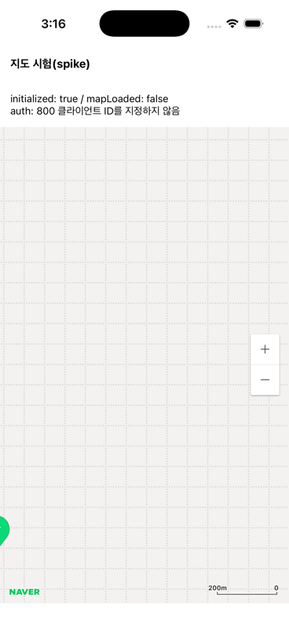
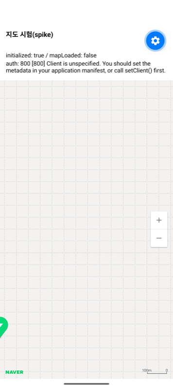

# 시험 보고: 네이버 지도 SDK (spike/naver-map)

임시 결정 T12(`docs/open-questions.md`)에 따라, 네이버 지도 SDK가 이 프로젝트에서 설치·빌드·실행되는지만 시험했다.
이 브랜치는 `dev`에 합치지 않는다. 시험 날짜는 2026-11-18이다.

표시: **[확인]** 직접 돌려 보고 확인한 것, **[문서]** 문서나 코드에서 읽은 것, **[추정]** 확인하지 않은 짐작.

## 1. 결론

**조건부로 된다.**

- iOS: 개발 빌드가 만들어지고, 지도 화면이 뜨고, 앱이 죽지 않는다. 키가 없어서 지도 타일은 안 나오고 인증 실패(800)가 난다. **[확인]**
- Android: 개발 빌드가 만들어지고(처음 빌드 1시간 36분), 에뮬레이터에서 지도 화면이 뜨고, 앱이 죽지 않는다. iOS와 똑같이 키가 없어서 타일이 안 나오고 인증 실패(800)가 난다. **[확인]**
- 웹: 이 라이브러리는 웹을 지원하지 않는다. **지도 라이브러리를 라우트 파일에서 바로 import하면 웹의 모든 화면이 500으로 깨진다.** 네이티브 전용 파일과 `.web.tsx` 파일로 나누면 웹의 다른 화면은 멀쩡하다. **[확인]**

조건:
1. Expo Go를 버리고 개발 빌드로 옮겨야 한다(네이티브 코드가 든 라이브러리라서). **[문서]**
2. 지도를 쓰는 컴포넌트는 반드시 플랫폼별 파일로 나눈다(웹 대체 파일 필요). **[확인]**
3. 실제 지도를 보려면 네이버 클라우드 플랫폼(NCP)에서 Maps 키를 발급하고 번들 ID·패키지 이름을 등록해야 한다. **[문서]**

## 2. 버전 표

| 항목 | 버전 | 근거 |
|---|---|---|
| Expo SDK | 58.0.24 | `package.json` |
| React Native | 0.88.1 (새 아키텍처) | `package.json` |
| React | 19.3.0 | `package.json` |
| `@mj-studio/react-native-naver-map` | 2.11.0 (2026-11-07 배포, 최신) | `npm view`, 2026-11-18 |
| 네이버 지도 네이티브 SDK | iOS `NMapsMap` 3.23.2, Android 3.23.2 | 라이브러리 podspec, README 배지 |
| `expo-build-properties` | ~58.0.12 | `npx expo install` |
| `expo-dev-client` | ~58.0.21 | `npx expo install` |
| Xcode | 26.6 | `xcodebuild -version` |
| CocoaPods | 1.16.2 | `pod --version` |
| iOS 시뮬레이터 | iPhone 17 Pro, iOS 26.5 | |
| Android JDK | Android Studio 내장 JBR 21.0.10 | 시스템 기본 Java는 8이라 쓸 수 없음 |

라이브러리 호환 정보 **[문서]**:
- `peerDependencies`는 `react: *`, `react-native: *`라 버전 제한이 없다. 라이브러리 자체 개발 환경은 RN 0.85.1, React 19.2.3이다(`devDependencies`). 즉 **RN 0.88은 라이브러리 저자가 시험한 버전보다 높다.** 이번 시험에서 iOS 빌드는 통과했다.
- 문서의 요구 사항: "New Architecture, +0.74", Expo는 "bare 또는 CNG, Expo Go는 안 됨".
- `codegenConfig`가 있는 Fabric 컴포넌트다(새 아키텍처 전용).
- 웹용 파일(`*.web.*`)이 하나도 없다. 진입점에서 `TurboModuleRegistry.getEnforcing('RNCNaverMapUtil')`을 바로 부른다.

## 3. 한 일과 걸린 문제

1. `npx expo install @mj-studio/react-native-naver-map expo-build-properties expo-dev-client` **[확인]** 13초. 문제 없음.
2. 설정 **[확인]**
   - `app.json`: `expo-build-properties`로 Android 메이븐 저장소(`https://repository.map.naver.com/archive/maven`) 추가(라이브러리 Expo 문서대로).
   - `app.json`: `ios.bundleIdentifier`, `android.package`를 **시험용 임시 값 `dev.moa.spike`** 로 넣었다. 원래 둘 다 없었다. 실제 값은 정해지지 않았다(키 발급 때 이 값을 등록해야 하므로 정식 값이 필요하다).
   - `app.config.js`(새 파일): 네이버 지도 config plugin을 여기서 넣고, `client_id`는 환경 변수 `NAVER_MAP_CLIENT_ID`에서 읽는다. 없으면 빈 값.
   - `npx expo install`이 플러그인을 `app.json`에 옵션 없이 문자열로 넣는데, 이 플러그인은 옵션 객체를 꼭 받아야 한다(`client_id`를 구조 분해함). 그래서 옮겼다. **[문서: 플러그인 코드]**
   - `npx expo prebuild`가 `package.json`의 `ios`, `android` 스크립트를 `expo run:ios|android`로 바꿨다. 시험 브랜치에서는 그대로 두었다.
3. `npx expo prebuild -p ios` **[확인]** 문제 없음. `Info.plist`에 `NMFNcpKeyId`, `NMFClientId`가 빈 값으로 들어간 것을 확인.
4. `npx expo run:ios` **[확인]** pod install(127개 pod, `NMapsMap 3.23.2` 포함) + 빌드 + 설치까지 **약 17분**(14:57:49 → 15:14:39, 첫 빌드, 캐시 없음). 오류 없이 `Build Succeeded`.
   - CocoaPods가 셸의 `LANG`이 UTF-8이 아니면 경고를 낸다. 명령 앞에 `LANG=en_US.UTF-8`을 붙여 돌렸다(셸 설정은 고치지 않음).
5. 시험 화면 `src/app/map-spike.tsx` + `src/components/map-spike/SpikeMap.tsx`(네이티브) + `SpikeMap.web.tsx`(웹 대체). 서울시청 좌표에 핀 하나.
6. 웹 **[확인]** 처음에는 라우트 파일에서 라이브러리를 바로 import했다. `npx expo export -p web`(정적 번들)은 통과했지만, `npx expo start --web`으로 열면 `/samples`, `/join/abc`, `/map-spike` **모두 500**이었다. 오류:
   ```
   Cannot read properties of undefined (reading 'getEnforcing')
   at node_modules/@mj-studio/react-native-naver-map/lib/module/spec/NativeRNCNaverMapUtil.js:4
   ... getRoutes / validateRouteTreeExports (expo-router)
   ```
   이 앱은 `web.output: "server"`라 Expo Router가 서버에서 **모든 라우트 파일을 한꺼번에 불러 검사**한다. 그래서 지도 화면 하나 때문에 웹 전체가 죽는다. 지도를 `SpikeMap.tsx`/`SpikeMap.web.tsx`로 나눈 뒤(`--clear`로 캐시를 지우고) 세 주소 모두 200, 브라우저에서 `/join/abc`(참여 화면)와 `/map-spike`(대체 문구)가 정상으로 뜨는 것을 확인했다.

## 4. 플랫폼별 결과

### iOS **[확인]**

- 지도 화면(`moaapp:///map-spike`): 회색 격자만 있는 빈 지도, 오른쪽 확대·축소 버튼, 왼쪽 아래 NAVER 로고, 축척 막대. 지도 끌기는 된다. 핀(초록 마커)은 보이지만 캡션 "서울시청"은 안 보였다.
- 인증 실패: `addNaverMapAuthFailureListener`로 `{"code": "800", "message": "클라이언트 ID를 지정하지 않음"}`을 받았다. 리스너가 있어서 SDK 기본 경고창은 뜨지 않았다(라이브러리 문서상 리스너가 있으면 기본 경고를 대신함 **[문서]**).
- `onInitialized`는 불렸고 `onMapLoaded`는 불리지 않았다(타일을 못 받아서로 보임 **[추정]**).
- 처음 카메라가 `initialRegion`(서울시청)에 맞춰지지 않은 것처럼 보였다(핀이 화면 왼쪽 아래 끝에 있었음). 키가 없어서인지, 라이브러리 문제인지는 확인하지 못했다.
- 앱은 죽지 않았다.



### 기존 화면, 개발 빌드에서 **[확인]**

- 홈: 정상.
- 약속 만들기(`/plans/new`): 정상으로 뜸(입력까지는 안 해 봄).
- 허브(`/plans/plan-recommended`, 추천 나옴): 정상. 후보를 누르면 체크되고 "투표하기"가 켜짐.
- 내 입력(`/plans/plan-collecting/input`): 날짜를 누르면 시간 카드가 뜨고, 시간 막대(TimeBar)의 손잡이를 끌면 종료 시각이 바뀌고 창이 밀린다(16:00 → 18:00). gesture-handler, reanimated 모두 개발 빌드에서 동작.
- Expo Go에서만 되던 것이 깨진 것은 이번에 본 범위에서는 없었다.
- 개발 빌드에는 오른쪽 위에 개발 도구 버튼(톱니바퀴, expo-dev-client)이 떠 있다. 화면 오른쪽 위 요소(공유 버튼 등)를 가릴 수 있다(개발 빌드에서만).
- Metro 로그에 `WARN ImageBackground is deprecated`가 반복된다. 우리 `src/`에는 `ImageBackground`가 없다. 어디서 나는지, Expo Go에서도 나는지는 확인하지 못했다.

### 앱이 꺼진 상태에서 링크로 열기 **[확인]**

- 앱을 끈 뒤 `moaapp:///plans/plan-recommended`를 열면, 먼저 개발 빌드의 런처 화면("Development servers")이 뜬다. 최근 서버를 누르면 **링크한 허브 화면으로 바로** 열렸다. 즉 링크 경로는 유지된다.
- 이 런처 단계는 개발 빌드(디버그)에만 있다. 정식(릴리스) 빌드에서는 런처가 없으니 바로 열릴 것이다 **[추정]**.
- 처음 링크를 열 때 iOS가 "'moa-app'에서 열겠습니까?" 확인 창을 띄운다(시뮬레이터에서 링크를 외부에서 열 때).

### Android **[확인]**

- 빌드: `expo run:android`(Pixel_9 에뮬레이터, Android Studio 내장 JBR 21). 15:18에 시작해 `BUILD SUCCESSFUL in 1h 36m 31s`가 나왔다(505개 작업). `gradle-9.4.1-bin.zip` 내려받기에만 10분 넘게 걸렸다. 빌드가 끝난 직후 Mac의 15분 평균 부하(load average)가 189였다. 시간 대부분이 첫 내려받기와 이 부하 때문인지는 나눠 재지 않았다 **[추정]**. 다시 빌드할 때도 이만큼 걸리는지는 재 보지 않았다.
- 네이버 지도 모듈(`:mj-studio_react-native-naver-map`)의 codegen과 컴파일이 오류 없이 지나갔다. 네이버 메이븐 저장소 설정(`extraMavenRepos`)으로 SDK를 받았다.
- 빌드하는 동안 에뮬레이터가 꺼졌다(exit 139, 로그에 `hanging thread 'QEMU2 CPU0 thread'`). 그래서 `expo run:android`가 설치 단계에서 `adb: device 'emulator-5554' not found`로 멈췄다. 이건 빌드 문제가 아니라 Mac 부하 때문으로 보인다 **[추정]**. 에뮬레이터를 다시 켠 뒤 만들어진 APK(`android/app/build/outputs/apk/debug/app-debug.apk`)를 `adb install`로 깔았다.
- 처음 열 때 Android가 "주변 기기 찾기" 권한을 묻는다(개발 빌드 런처가 같은 네트워크의 개발 서버를 찾느라 묻는 것으로 보임 **[추정]**). "허용 안 함"을 눌러도 `adb reverse tcp:8081 tcp:8081` 후 `moaapp://expo-development-client/?url=http%3A%2F%2Flocalhost%3A8081`로 서버에 붙었다. 이 주소의 `url`에 화면 경로(`/--/map-spike`)를 붙이면 "Failed to open app"으로 실패한다. 서버에 붙은 뒤 `moaapp:///map-spike`를 따로 열어야 했다.
- 홈: 정상으로 뜬다(오늘의 약속 카드, 다음 약속 목록). 다른 화면은 Android에서 눌러 보지 않았다.
- 지도 화면: iOS와 같다. 회색 격자, 확대·축소 버튼, NAVER 로고, 축척 막대가 나온다. `[map-spike] auth failure {"code": "800", "message": "[800] Client is unspecified. ..."}`이 오고, `initialized`는 true, `mapLoaded`는 false다. 핀은 화면 왼쪽 아래 끝에 반쯤 걸쳐 있고 캡션은 보이지 않는다. iOS와 같은 모양이라, 처음 카메라 위치 문제는 한쪽 플랫폼만의 일이 아니다.
- 앱은 죽지 않았다.



### 웹 **[확인]**

- 라이브러리는 웹을 지원하지 않는다. import만 해도 죽는다(위 3절 6번).
- 대책: 지도를 쓰는 컴포넌트를 `X.tsx`(네이티브) + `X.web.tsx`(웹)로 나누고, 라우트 파일에서는 이 라이브러리를 직접 import하지 않는다. Metro가 웹에서는 `.web.tsx`를 고른다.
- 웹에서 실제 지도를 보이려면 **네이버 지도 JavaScript API v3**(NCP Maps의 Dynamic Map, 웹용)를 `X.web.tsx` 안에서 따로 붙여야 한다 **[문서, 조사만]**. 같은 NCP Application에 Web 서비스 URL을 등록해야 하고, 스크립트 주소의 파라미터 이름이 `ncpClientId`에서 `ncpKeyId`로 바뀌었다고 공식 튜토리얼에 적혀 있다. 서비스 URL에 포트가 들어가면 인증 오류가 날 수 있다고 한다(로컬 `localhost:8081` 시험 때 주의).
- 게스트 화면(웹)에 지도가 꼭 필요한지부터 정해야 한다. 필요 없다면 웹은 "주소 텍스트 + 네이버 지도 앱/웹으로 열기 링크"만으로도 될 수 있다 **[추정, 결정 아님]**.

## 5. 키가 있으면 추가로 확인할 것

- 타일이 실제로 뜨는지, `onMapLoaded`가 불리는지.
- 처음 카메라가 `initialRegion`에 맞는지(키 없이 어긋났던 것).
- 마커 캡션 글자가 보이는지.
- 번들 ID/패키지 이름이 등록 값과 다를 때 401이 나는지(설정 실수 확인용).
- Android에서도 같은 동작인지.
- 웹(JavaScript API)에서 Web 서비스 URL 등록과 `localhost` 개발 환경이 맞는지.
- 무료 사용량: 라이브러리 API Key 문서에 "일 25,000회, 월 300,000회 무료"라고 적혀 있다(2026-11-18 확인, NCP 요금 페이지는 직접 확인하지 않음. 바뀔 수 있음).

## 6. 키를 넣는 방법

- 발급 **[문서]**: NCP 가입(이메일·휴대폰 인증, **결제 수단 등록 필요**) → 콘솔에서 Application 등록 → Maps 선택 → 서비스 환경에 iOS Bundle ID, Android 패키지 이름(웹을 쓰면 Web 서비스 URL) 입력 → Client ID 복사. 번들 ID·패키지 이름은 앱 설정과 정확히 같아야 한다.
- 넣는 곳 **[확인]**: 이 브랜치의 `app.config.js`가 `process.env.NAVER_MAP_CLIENT_ID`를 config plugin에 넘긴다. 플러그인은 그 값을 iOS `Info.plist`(`NMFNcpKeyId`)와 Android `AndroidManifest.xml`(`com.naver.maps.map.NCP_KEY_ID`)에 넣는다. 로컬에서는:
  ```bash
  NAVER_MAP_CLIENT_ID=발급받은값 npx expo prebuild --clean
  ```
  또는 `.env.local`(이미 `.gitignore`의 `.env*.local`에 걸림)에 적는다. Expo CLI가 `.env` 파일을 `app.config.js` 평가 때 읽는지는 확인하지 않았다 **[추정: 읽는다]**. EAS 빌드에서는 EAS 환경 변수로 넣는다 **[문서]**.
- `EXPO_PUBLIC_` 접두사는 쓰지 않는다. 그건 JS 번들에 그대로 박힌다 **[문서]**. 다만 이 Client ID는 어차피 앱 안(`Info.plist` 등)에 들어가는 값이라 완전한 비밀은 아니다. 막는 장치는 NCP에 등록한 번들 ID·패키지 이름·웹 URL이다 **[문서]**. 그래도 저장소에는 커밋하지 않는다.
- 플러그인 버그 하나 **[문서: 플러그인 코드]**: `ios.NSLocationWhenInUseUsageDescription` 옵션을 주면 `NSLocationAlwaysUsageDescription` 키에 써 버린다. 위치 권한 문구가 필요하면 이 플러그인 옵션 대신 `expo-location` 플러그인으로 넣는다.

## 7. 개발 빌드로 넘어가면 달라지는 것

- **빌드 시간**: 첫 iOS 빌드 약 17분(이 Mac 기준). 이후 JS만 바꾸면 Metro 새로고침이라 지금과 같다. 네이티브 라이브러리를 추가하거나 `app.json`/`app.config.js`를 바꾸면 다시 prebuild + 빌드해야 한다 **[문서]**.
- **실행 방법**: `npx expo start`가 Expo Go 대신 개발 빌드 앱을 향한다. 시뮬레이터에 개발 빌드 앱(`moa-app`, 번들 ID `dev.moa.spike`)이 깔려 있어야 한다.
- **팀원 환경**: 각자 Xcode + CocoaPods(iOS), Android Studio + JDK 17 이상(Android)이 필요하다. 이 Mac은 시스템 기본 Java가 8이라 Android 빌드 때 `JAVA_HOME`을 Android Studio 내장 JBR로 지정해야 했다. 대안: EAS로 개발 빌드를 클라우드에서 만들어 나눠 쓰기(`eas build --profile development`). EAS 무료 한도는 확인하지 않았다.
- **하위 세션의 확인 방법**: 지금은 Expo Go로 바로 열어 확인한다. 개발 빌드로 가면, 네이티브가 바뀌지 않은 작업은 이미 깔린 개발 빌드 앱 + `npx expo start --dev-client`로 확인하면 된다. 네이티브가 바뀌는 작업(라이브러리 추가)은 그 세션이 다시 빌드해야 하고 15분 이상 걸린다. `ios/`, `android/`는 git이 무시하므로 브랜치를 바꿔도 남는다 → 다른 브랜치의 네이티브 설정이 섞일 수 있으니 `npx expo prebuild --clean`을 습관으로.
- **링크**: 개발 빌드에서는 앱이 꺼진 상태에서 링크를 열면 런처를 한 번 거친다(4절).
- **CNG 유지**: `ios/`, `android/`는 계속 손대지 않고 `app.json`/`app.config.js`와 플러그인으로만 설정한다.

## 8. 지도를 실제로 넣을 때 권하는 순서

1. 결정: 정식 번들 ID·패키지 이름, 웹(게스트)에 지도가 필요한지, 길찾기 API(미결정)와 같은 NCP 계정을 쓸지.
2. NCP 키 발급(사용자 또는 팀). 결제 수단 등록이 필요하다.
3. 별도 브랜치에서 개발 빌드로 전환: `expo-dev-client` 추가, `app.config.js`로 키 주입, `.gitignore`/README에 키 넣는 법 적기. 이때 팀원 전원이 빌드되는지 먼저 확인.
4. 지도 컴포넌트를 `src/components/<기능>/` 아래에 네이티브/웹 두 파일로 만든다. 웹 파일은 처음엔 대체 표시만.
5. 키를 넣은 상태로 5절 목록을 확인.
6. 웹 지도가 필요하면 JavaScript API로 웹 파일을 채운다.

## 9. 확인하지 못한 것

- 키를 넣은 상태의 모든 동작(5절).
- 실기기(아이폰, 안드로이드 폰).
- Android에서 홈 말고 다른 화면(허브, 내 입력의 시간 막대 등), 앱이 꺼진 상태에서 링크로 열기.
- Android 두 번째 빌드에 걸리는 시간.
- 릴리스 빌드, EAS 빌드.
- `initialRegion`이 어긋나 보인 원인, 마커 캡션이 안 보인 원인.
- `ImageBackground` 경고의 출처.
- 약속 만들기 화면의 입력 흐름 전체, 온보딩, 참여 화면(개발 빌드에서).

## 10. 시험 뒤 남은 것

- iOS 시뮬레이터에 개발 빌드 앱(`dev.moa.spike`, 이름 moa-app)이 깔린 채로 남아 있다. Expo Go와는 별개 앱이다. 지워도 된다.
- Android 에뮬레이터(Pixel_9)에도 같은 앱이 남아 있다(에뮬레이터는 껐다).
- 작업 폴더의 `ios/`, `android/`(prebuild가 만든 것, git이 무시함)는 `dev`로 돌아가면서 지웠다.
