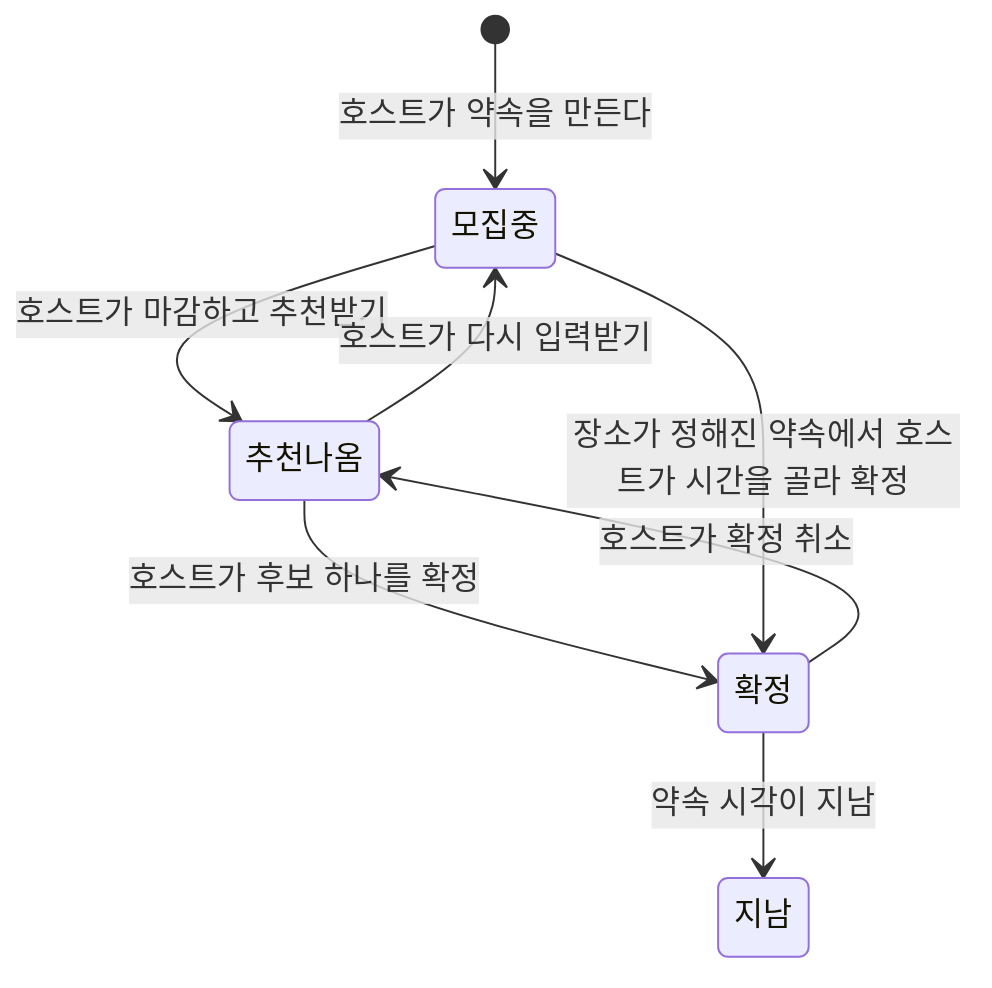
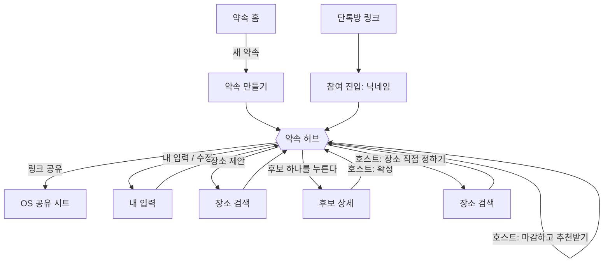

# moa 사용자 흐름

- 기준일: 2026-11-13
- 범위: 홈에서 약속을 만들고, 각자 일정과 출발지를 넣고, 시간과 장소를 추천받아 확정하기까지
- 이 문서는 `docs/architecture.md`의 2.1(파일 트리의 `plans/` 부분)과 3장(사용자 흐름)을 **대체한다.** 나머지 장은 그대로다.
- 길찾기 API, 실시간 반영, 게스트 인증은 여전히 미결정이다. 이 문서는 셋 중 무엇을 고르든 성립하도록 썼다.

## 1. 정한 것 (2026-11-13)

| # | 결정 | 이유 |
|---|---|---|
| 1 | 초대는 **링크만** 쓴다. 친구 목록 화면(피그마 `약속 생성_1`)은 쓰지 않는다 | 친구 목록 데이터의 출처가 없다 |
| 2 | **링크 공유는 참가자 누구나** 할 수 있다 | 단톡방이 여러 개이거나 호스트가 바쁠 때 막히지 않는다 |
| 3 | 후보 날짜와 필요한 시간 길이는 **호스트가 만들 때** 정한다 | 각자 달력 전체에서 고르면 겹치는 날이 나오지 않는다 |
| 4 | 가능 시간, 출발지, 이동수단을 **한 번에** 입력받는다 | 모두가 응답해야 하는 라운드를 1번으로 줄인다 |
| 5 | 입력 마감은 **호스트가 수동으로** 한다 | 링크 초대에서는 총인원을 미리 알 수 없다 |
| 6 | 최종 확정은 **호스트가** 한다. 투표는 MVP에 없다 | 라운드를 늘리지 않는다 |
| 7 | 장소 방식(`추천받기` / `정해져 있음`)은 **만들 때** 묻는다 | 참가자가 넣을 것이 달라진다 |
| 8 | 호스트는 확정 전까지 언제든 **장소를 직접 정해 확정**할 수 있다 | 이미 받은 출발지를 안 쓰면 되므로 비용이 없다 |
| 9 | 참가자는 **장소를 제안**할 수 있고, 제안은 후보 중 하나로 올라간다 | "여기 어때?"를 앱 밖에서 따로 말하지 않게 한다 |
| 10 | **약속 허브** 화면 하나가 구심점이다. 확정 뒤에는 같은 화면이 약속 상세가 된다 | 링크와 홈 카드가 항상 같은 곳으로 간다 |
| 11 | 주변 가게 추천은 확정 뒤의 선택 기능이다. MVP 필수 단계가 아니다 | 범위를 줄인다 |

## 2. 역할과 권한

| 할 수 있는 일 | 호스트 | 참가자 |
|---|---|---|
| 약속 만들기 | O | |
| 링크 공유 | O | O |
| 내 가능 시간·출발지·이동수단 입력과 수정 | O | O |
| 장소 제안 | O | O |
| 약속 정보 수정(이름, 후보 날짜, 시간 길이) | O | |
| 장소 방식 바꾸기, 장소 직접 정하기 | O | |
| 입력 마감하고 추천받기, 다시 입력받기 | O | |
| 확정, 확정 취소 | O | |

- 호스트는 앱에 로그인한 사람이다. 참가자는 링크로 들어온 사람이고 가입하지 않는다(게스트 웹).
- 앱을 쓰는 사람이 링크로 참가하는 경우도 참가자와 같은 흐름이다. 로그인돼 있으면 닉네임 입력만 건너뛴다.
- 서버가 "이 사람이 호스트인지, 같은 참가자가 다시 온 것인지"를 어떻게 알아보는지는 게스트 인증과 함께 미결정이다.

## 3. 약속의 상태



| 상태 | 뜻 | 홈 카드 라벨(초안) |
|---|---|---|
| 모집 중 | 참가자들이 입력하는 중 | "일정 모으는 중" |
| 추천 나옴 | 후보가 나왔고 확정을 기다린다 | "확정 대기" |
| 확정 | 일시와 장소가 정해졌다 | "내일", "3일 뒤", "10분 후" |
| 지남 | 약속 시각이 지났다 | 홈에서 내려간다 |

피그마 홈 카드의 "장소 조율 중", "일정 확정", "장소 확정" 라벨은 시간과 장소를 따로 정하던 흐름의 것이라 위 라벨로 바뀐다.

## 4. 전체 흐름



호스트 기준으로 한 줄로 쓰면: **만들기 → 링크 공유 → 내 입력 → (다른 사람 입력 대기) → 마감하고 추천받기 → 후보 확인 → 확정**.
참가자 기준: **링크 → 닉네임 → 내 입력 → (대기) → 후보 확인 → 확정된 약속 보기**.

## 5. 화면과 라우트

```
src/app/
├── (tabs)/index.tsx                    약속 홈
├── plans/
│   ├── new.tsx                         약속 만들기
│   └── [planId]/
│       ├── _layout.tsx                 Stack
│       ├── index.tsx                   약속 허브 (모집 중 / 추천 나옴 / 확정)
│       ├── input.tsx                   내 입력
│       ├── place-search.tsx            장소 검색 (제안, 직접 정하기, 출발지 공용)
│       └── candidates/[candidateId].tsx  후보 상세
└── join/[code].tsx                     참여 진입 → 허브로 이동
```

| # | 화면 | 피그마 | 상태 |
|---|---|---|---|
| 1 | 약속 홈 | `MAIN.` | 있음. 새 약속 버튼과 카드 라벨 수정 필요 |
| 2 | 약속 만들기 | `약속 생성_2` 일부 | **수정 필요.** 후보 날짜, 시간 길이, 장소 방식이 없다 |
| 3 | 참여 진입 | 없음 | **새로 필요** |
| 4 | 약속 허브: 모집 중 | `장소 조율_1` 일부 | **새로 필요.** 참가자 입력 현황 부분은 재사용 |
| 5 | 약속 허브: 추천 나옴 | `날짜 선택_4-1`(미완) | **완성 필요.** 장소 이름이 후보에 같이 보여야 한다 |
| 6 | 약속 허브: 확정 | 없음 | **새로 필요** |
| 7 | 내 입력 | `날짜 선택_1`, `_1-2`, `_2`, `_3` | 있음. 이동수단 선택과 후보 날짜 밖 비활성 표시 추가 필요 |
| 8 | 장소 검색 | 없음 | **새로 필요** |
| 9 | 후보 상세 | `장소 조율_2` | 있음. 확정 버튼(호스트)으로 문구 수정 필요 |

쓰지 않게 된 것: `약속 생성_1`(친구 초대). 단계 표시(1/3, 2/3)는 허브 구조에서는 필요 없다. 내 입력 화면 안의 단계로만 남길지는 디자이너와 정한다.

## 6. 화면별 내용

### 6.1 약속 만들기 (호스트)

| 입력 | 필수 | 메모 |
|---|---|---|
| 약속 이름 | O | 50자 |
| 사진 | | |
| 후보 날짜 | O | 달력에서 여러 날을 고른다 |
| 필요한 시간 길이 | O | 예: 1시간, 2시간, 3시간. 공통 시간 계산의 기준 |
| 장소 방식 | O | `추천받기`(기본) / `정해져 있음` |
| 장소 | 방식이 `정해져 있음`일 때 | 장소 검색으로 고른다 |

만들면 허브로 이동한다. 호스트도 참가자이므로 허브에서 자기 입력을 한다.

### 6.2 참여 진입 (링크)

- 약속 요약을 보여준다: 이름, 호스트, 후보 날짜, 장소(정해져 있으면).
- 닉네임을 받는다. 앱에 로그인돼 있으면 건너뛴다.
- 다음에 다시 링크를 누르면 닉네임을 다시 묻지 않고 허브로 간다(방법은 게스트 인증과 함께 미결정).

### 6.3 내 입력

한 사람의 입력은 **묶음 여러 개 + 이동수단 하나**다.

| 입력 | 필수 | 메모 |
|---|---|---|
| 묶음: 날짜들 | O | 후보 날짜 중에서만 고른다. 나머지 날짜는 비활성 |
| 묶음: 시작·종료 시각 | O | 시간 패널의 휠 |
| 묶음: 출발지 | 장소 방식이 `추천받기`일 때 O | 시간 패널 아래의 장소 줄. 장소 검색으로 고른다 |
| 이동수단 | 장소 방식이 `추천받기`일 때 O | 대중교통 / 자차. 사람당 하나 |

- 묶음 예: "4월 1일·22일·24일, 10:00~16:00, 중앙대에서 출발". 요일마다 시간이나 출발지가 다르면 묶음을 하나 더 만든다(날짜 요약 카드의 `+`).
- "내 일정" 토글은 앱에서만 보인다. 기기 캘린더 일정을 달력에 겹쳐 보여줄 뿐이고 서버로 보내지 않는다.
- 장소 방식이 `정해져 있음`이면 출발지와 이동수단을 묻지 않는다.
- 저장하면 허브로 돌아간다. 마감 전까지 몇 번이든 고칠 수 있다.

### 6.4 약속 허브

위쪽은 세 상태가 같다: 약속 이름, 사진, 참가자 줄, 링크 공유 버튼.

| 상태 | 모두에게 보이는 것 | 호스트에게만 보이는 것 |
|---|---|---|
| **모집 중** | 후보 날짜와 시간 길이, 장소(정해졌거나 "추천받을 예정"), 참가자별 입력 여부, 제안된 장소 목록, `내 가능 시간 입력`(또는 `수정`), `장소 제안` | `마감하고 추천받기`, `장소 직접 정하기`, 약속 정보 수정 |
| **추천 나옴** | 후보 목록(6.5), `장소 제안` | 후보 `확정`, `장소 직접 정하기`, `다시 입력받기` |
| **확정** | 일시, 장소와 지도, 참가자, 내 이동 안내(출발지를 넣은 경우), `캘린더에 추가` | `확정 취소` |

- 아직 입력하지 않은 사람에게는 모집 중 화면의 가장 큰 버튼이 `내 가능 시간 입력`이다.
- 장소 방식이 `정해져 있음`인 약속은 모집 중 화면에 지금까지의 공통 가능 시간이 바로 보이고, 호스트가 그중 하나를 골라 확정할 수 있다(추천 단계를 건너뛴다).
- 화면 파일은 상태를 보고 내용 컴포넌트 셋 중 하나를 고르기만 한다. 세 내용은 `src/components/plan-hub/` 아래에 따로 둔다.

### 6.5 후보와 후보 상세

후보 하나는 **시간 + 장소** 묶음이다.

| 후보에 보이는 것 | 예 |
|---|---|
| 날짜와 시간 | 4월 25일 토요일, 오후 1:30 ~ 5:00 |
| 장소 | 사당역 |
| 출처 | "추천" 또는 "해진 제안" |
| 참석 가능 인원 | 4명 모두 / 3명 가능(예희 제외) |
| 평균·최대 이동시간 | 평균 38분, 최대 42분 |

- 추천 후보는 최대 3개다. 그 아래에 참가자가 제안한 장소가 후보로 붙는다.
- 제안된 장소는 그 장소 기준으로 가장 좋은 시간 하나와 묶여 후보가 된다.
- 후보 상세(`장소 조율_2`)는 지도, 사람별 이동수단·소요시간·환승을 보여준다. 호스트에게는 `이 후보로 확정` 버튼이 보인다.
- 장소 방식이 `정해져 있음`이면 후보는 시간만 다르고 장소는 같다.

### 6.6 장소 검색

같은 화면을 세 곳에서 쓴다: 출발지 고르기(내 입력), 장소 제안(허브), 장소 직접 정하기(허브, 호스트).
검색에 쓸 API는 카카오 로컬 API가 후보다(위키 2026-11-06). 아직 붙여 보지 않았다.

## 7. 장소 방식과 장소 제안

### 7.1 장소 방식 바꾸기

| 방향 | 언제 가능한가 | 이유 |
|---|---|---|
| `추천받기` → `정해져 있음` | 확정 전까지 언제든 (호스트) | 이미 받은 출발지는 쓰지 않으면 된다 |
| `정해져 있음` → `추천받기` | 호스트 말고 아무도 입력하기 전까지만 | 입력한 사람 모두에게 출발지를 다시 받아야 한다 |
| `정해져 있음`의 장소를 다른 곳으로 | 확정 전까지 언제든 (호스트) | |

호스트의 `장소 직접 정하기`는 첫 번째 줄과 같은 동작이다. 추천 나옴 상태에서 누르면 그 장소와 고른 시간으로 바로 확정할 수 있다.

### 7.2 장소 제안 (참가자)

- 모집 중과 추천 나옴 상태에서 할 수 있다. 확정 뒤에는 할 수 없다.
- 한 사람이 제안할 수 있는 장소는 1개다(초안). 다시 제안하면 이전 것을 바꾼다.
- 모집 중에 들어온 제안은 허브에 목록으로 보이고, 추천이 나올 때 후보로 계산된다.
- 추천 나옴 상태에서 들어온 제안은 서버가 그 장소만 계산해 후보 목록에 추가한다.
- 장소 방식이 `정해져 있음`이어도 제안할 수 있다. 호스트가 보고 장소를 바꿀지 정한다.
- 제안에 대한 찬성 표시나 투표는 MVP에 없다.

## 8. 경우의 수

| 경우 | 처리 |
|---|---|
| 모두 되는 시간이 없다 | 가장 많은 사람이 되는 시간을 후보로 내고 빠지는 사람을 표시한다 |
| 한 명도 겹치지 않는다 | 후보 없음. 호스트에게 `다시 입력받기`나 후보 날짜 수정을 안내한다 |
| 마감 뒤에 새 참가자가 들어왔다 | 추천 나옴 상태에서도 입력은 받는다. 후보는 호스트가 `다시 입력받기` → `마감하고 추천받기`를 해야 갱신된다 |
| 마감 뒤에 입력을 고치고 싶다 | 위와 같다 |
| 확정 뒤에 들어왔다 | 확정된 약속을 보기만 한다. 참가자 줄에 추가된다 |
| 호스트가 후보 날짜를 바꿨다 | 빠진 날짜의 입력은 버린다. 입력한 사람에게 허브에서 알린다 |
| 호스트 혼자만 입력했다 | 마감할 수 있다. 후보는 호스트 기준으로 나온다 |
| 출발지를 넣지 않았다 | `추천받기`에서는 필수라 저장할 수 없다 |
| 자차인 사람이 있다 | 그 사람의 소요시간은 자동차 기준으로 계산한다. 환승은 표시하지 않는다 |
| 참가하지 않겠다 | MVP에서는 "입력 안 함"으로 남는다. 불참 표시는 나중에 |
| 확정을 취소했다 | 추천 나옴으로 돌아간다. 참가자에게 허브에서 알린다 |

앱 밖 알림(푸시, 카톡 메시지)은 MVP에 없다. 변화는 허브를 열었을 때 보인다. 허브를 얼마나 자주 새로 고치는지는 실시간 반영 방식과 함께 미결정이다.

## 9. 서버에 필요한 것 (초안)

`docs/architecture.md` 5.4의 타입 초안을 아래로 바꾼다. 필드 이름과 값은 백엔드와 맞춰야 하는 초안이다.

```ts
type Plan = {
  id: string;
  title: string;
  imageUrl: string | null;
  hostId: string;
  status: 'collecting' | 'recommended' | 'confirmed' | 'past';
  candidateDates: string[];        // ["2026-04-01", "2026-04-22", "2026-04-24"]
  durationMinutes: number;         // 120
  placeMode: 'recommend' | 'fixed';
  fixedPlace: Place | null;        // placeMode가 'fixed'일 때
  confirmed: { startsAt: string; endsAt: string; place: Place } | null;
  members: Member[];
};

type Place = { name: string; lat: number; lng: number };

type Member = {
  id: string;
  name: string;
  avatarUrl: string | null;
  submitted: boolean;
};

// 한 사람의 입력
type Submission = {
  planId: string;
  memberId: string;
  mode: 'transit' | 'car' | null;  // placeMode가 'fixed'면 null
  groups: {
    dates: string[];
    start: string;                 // "10:00"
    end: string;                   // "16:00"
    origin: Place | null;          // placeMode가 'fixed'면 null
  }[];
};

type PlaceProposal = { id: string; memberId: string; place: Place };

type Candidate = {
  id: string;
  startsAt: string;
  endsAt: string;
  place: Place;
  source: 'recommended' | 'proposed' | 'fixed';
  proposedBy: string | null;       // memberId
  attendeeIds: string[];
  avgMinutes: number | null;       // 출발지가 없으면 null
  maxMinutes: number | null;
  routes: {
    memberId: string;
    mode: 'transit' | 'car';
    minutes: number;
    transfers: number | null;
  }[];
};
```

필요한 동작(이름은 `src/api/` 함수 초안):

| 동작 | 누가 |
|---|---|
| `createPlan` | 호스트 |
| `getPlan`, `getCandidates`, `getProposals` | 모두 |
| `joinPlan(code, nickname)` | 참가자 |
| `submitAvailability`, `getMySubmission` | 모두 |
| `proposePlace` | 모두 |
| `updatePlan`(이름, 후보 날짜, 시간 길이, 장소 방식, 장소) | 호스트 |
| `closeAndRecommend`, `reopen` | 호스트 |
| `confirm(candidateId)`, `confirmCustom(시간, 장소)`, `unconfirm` | 호스트 |

## 10. 디자이너에게 요청할 것

우선순위 순서다. 1~3이 없으면 홈에서 다음으로 나아갈 수 없다.

1. **약속 허브: 모집 중.** 참가자 입력 현황, 링크 공유, 내 입력 버튼, 장소 제안, 호스트용 마감 버튼
2. **약속 만들기 수정.** 후보 날짜, 시간 길이, 장소 방식(정해져 있으면 장소 선택)
3. **내 입력 수정.** 이동수단 선택, 후보 날짜 밖 비활성 표시, 묶음을 여러 개 만드는 방법, 시간 패널이 열렸을 때의 달력(최신 달력 기준)
4. **약속 허브: 추천 나옴.** `날짜 선택_4-1`을 "시간 + 장소" 후보 카드로 완성. 제안된 장소의 표시
5. **후보 상세 수정.** `장소 조율_2`에 호스트용 확정 버튼
6. **참여 진입.** 약속 요약과 닉네임
7. **장소 검색.** 출발지, 제안, 직접 정하기 공용
8. **약속 허브: 확정.** 일시, 장소, 지도, 내 이동 안내, 캘린더에 추가
9. **약속 홈 수정.** 새 약속 버튼, 카드 라벨

## 11. 남은 질문

| # | 질문 | 누구와 |
|---|---|---|
| Q1 | 필요한 시간 길이의 선택지(30분 단위인지, 최대 몇 시간인지) | 디자이너 |
| Q2 | 장소 제안을 한 사람당 1개로 제한할지 | 팀 |
| Q3 | 후보를 고를 때의 기준(참석 인원 우선인지, 이동시간 우선인지)과 후보 개수 | 백엔드(알고리즘 공동 설계) |
| Q4 | 자차와 대중교통이 섞였을 때의 중간 지점 계산. 자동차 길찾기 API가 따로 필요한지 | 백엔드. 길찾기 API 결정에 포함 |
| Q5 | 링크의 코드가 약속 id와 같은지, 만료가 있는지 | 백엔드. 게스트 인증 결정에 포함 |
| Q6 | 호스트가 앱을 지우거나 사라졌을 때 다른 사람이 확정할 수 있게 할지 | 팀. MVP에서는 다루지 않기를 권한다 |
| Q7 | 시간만 정해져 있고 장소만 정하면 되는 약속을 지원할지 | 팀. MVP에서는 빼기를 권한다 |
| Q8 | 확정 뒤 주변 가게 추천과 사람별 상세 이동 안내의 범위 | 팀 |
